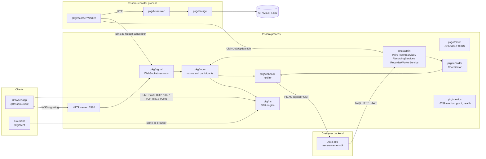
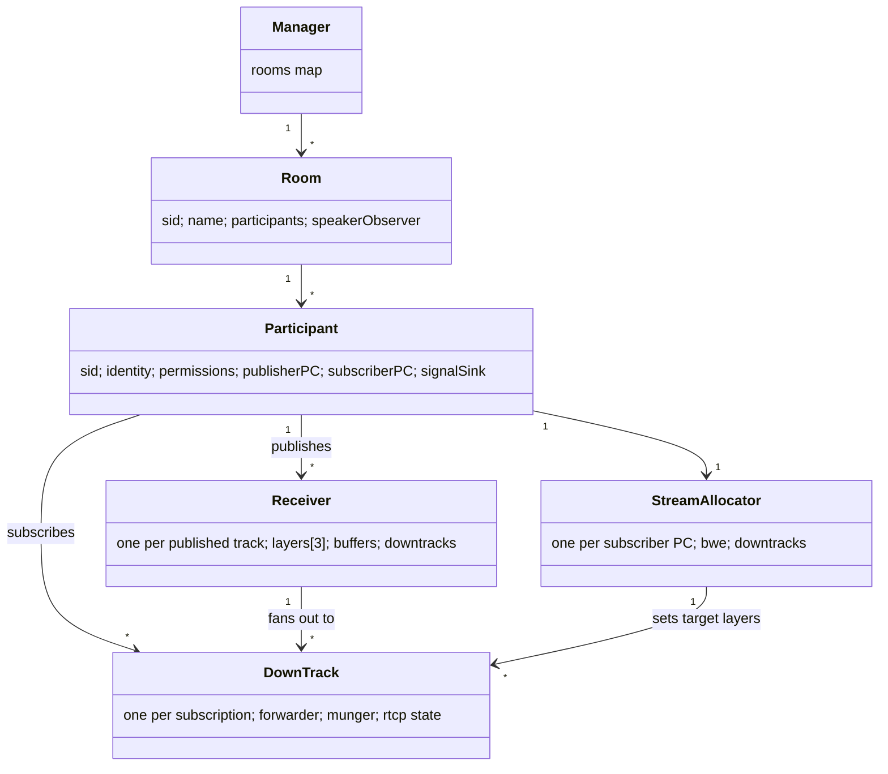
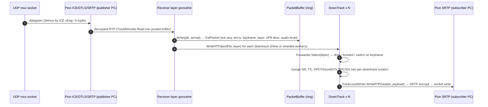
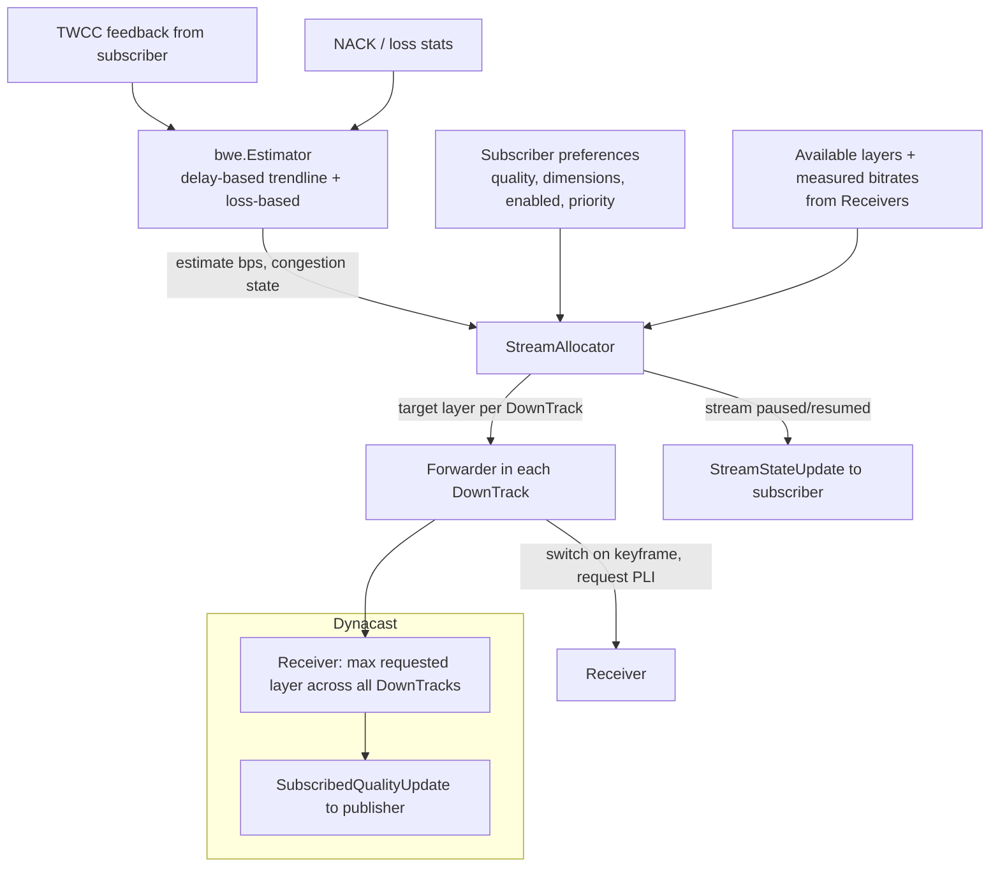
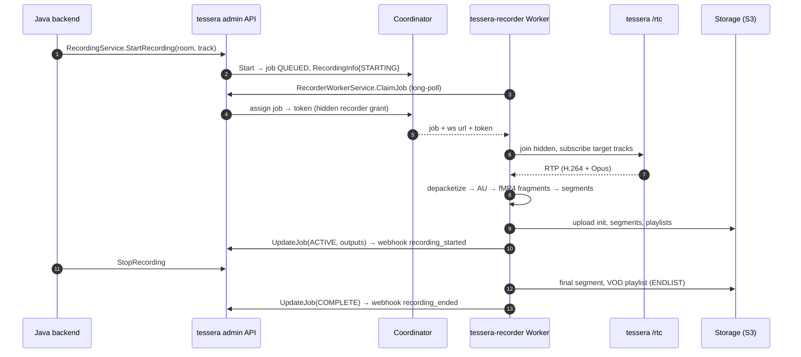
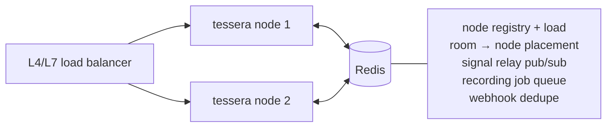

# Tessera architecture

Tessera is a WebRTC Selective Forwarding Unit (SFU) with HLS recording, a TypeScript browser
SDK and a Java server SDK. This document describes the components, the process and goroutine
model, the forwarding hot path, memory management, scaling and the performance targets every
work package is measured against. Decisions are recorded as ADRs in [`docs/adr`](adr/README.md);
the wire protocol is in [PROTOCOL.md](PROTOCOL.md).

## 1. Components



| Component | Package | Owner | Responsibility |
|-----------|---------|-------|----------------|
| Config | `pkg/config` | WP1 | YAML + env config, validation, logger construction |
| Auth | `pkg/auth` | WP1 | API keys, JWT claims/grants, token minting and verification |
| Signaling | `pkg/signal` | WP1 | `/rtc` WebSocket endpoint, framing, ping/pong, write queues |
| Rooms | `pkg/room` | WP1 | Room/participant lifecycle, subscriptions, permissions, events, admin operations |
| SFU engine | `pkg/rtc/...` | WP1 | PeerConnections, receivers, downtracks, buffers, simulcast, BWE, speakers, TURN |
| Go client | `pkg/client` | WP1 | Pion-based client for tests, recorder and load tester |
| Admin API | `pkg/admin` | WP3 | Twirp server and client helpers, auth checks, error mapping |
| Webhooks | `pkg/webhook` | WP3 | Event queueing, signing, retries; signature verification helpers |
| Recording control | `pkg/recorder` | WP4 | Coordinator (in `tessera`) and Worker (in `tessera-recorder`) |
| HLS muxer | `pkg/hls` | WP4 | RTP depacketizers, fMP4/CMAF writer, playlists |
| Storage | `pkg/storage` | WP4 | Local and S3-compatible upload |
| Metrics | `pkg/metrics` | WP5 (Phase 0 impl.) | Registry, metrics/pprof/health HTTP server |
| Errors | `pkg/errs` | shared, frozen | Error sentinels shared by all packages |
| Protocol | `proto/`, `gen/go` | shared, frozen | Signaling, admin, webhook and recording schemas |

## 2. Process model

- **`tessera`**: one process per node, using all cores (`GOMAXPROCS` = container CPU quota,
  honoured automatically by Go 1.25+). It hosts signaling, admin API, the SFU engine,
  embedded TURN and the recording Coordinator. Media is never transcoded.
- **`tessera-recorder`**: N replicas, each handling many jobs, pulling work from the
  Coordinator. Spawns FFmpeg subprocesses only for AAC mode, VP8 sources and (later)
  composite layouts.
- **`tessera-loadtest`**: simulated publishers/subscribers built on `pkg/client`, publishing
  synthetic or file-based RTP (no encoder), reporting latency, loss and join times.

Listeners (defaults): `:7880/tcp` HTTP (signal `/rtc`, admin `/twirp/...`), `:7881/tcp`
ICE-TCP, `:7882/udp` media mux, `:3478` TURN, `:443` or `:5349` TURNS (optional), `:6789` metrics/pprof/health.

## 3. Object model



- A **Receiver** represents one published track with up to three simulcast layers. Each layer
  has its own SSRC, `PacketBuffer` and statistics. A Receiver is source-agnostic: its input
  is an `RTPSource` (a Pion `TrackRemote` today, a relay from another node later).
- A **DownTrack** is one subscriber's view of one Receiver. It implements `webrtc.TrackLocal`
  (bound to a transceiver on the subscriber PC) and owns a `simulcast.Forwarder` that decides
  which incoming packets to forward and how to rewrite them.
- The **StreamAllocator** (one per subscriber PC) distributes the subscriber's estimated
  downlink bandwidth over its DownTracks by priority and requested quality.
- The **SpeakerObserver** (one per room) aggregates audio levels from all audio Receivers.

## 4. Media data flow and goroutine model

### 4.1 Forwarding path



**Goroutines on the hot path**

| Goroutine | Count | Work |
|-----------|-------|------|
| Pion ICE/DTLS read loop | 1 per mux socket + per DTLS conn | Demux, decrypt (owned by Pion) |
| `Receiver` layer reader | 1 per published SSRC (≤ 3 per video track, 1 per audio) | Read RTP, buffer, parse, fan out |
| Fan-out workers | shared pool, `GOMAXPROCS` | Only when a layer has more than `fanout_inline_max` (default 32) DownTracks: downtracks are split into fixed shards processed in parallel; the reader waits for completion so per-downtrack order is preserved |
| RTCP reader (publisher) | 1 per publisher PC | SR (for timestamp mapping), sender stats |
| RTCP reader (subscriber) | 1 per subscriber PC | NACK, PLI/FIR, RR, TWCC feedback → DownTrack / allocator |
| `StreamAllocator` | 1 per subscriber PC | Event-driven + 500 ms tick; never on the per-packet path |
| RTCP writer | 1 per PC | Batches SR/RR/PLI/NACK/TWCC, sends every 1 s or on demand (PLI) |
| Room worker | 1 per room | Participant updates, speaker detection (every 300 ms), connection quality (every 5 s), dynacast aggregation |
| Signal session | 2 per participant (reader, writer) | Decode requests; bounded write queue |

**Rules for the hot path** (enforced by benchmarks and code review):

1. No allocation per packet in steady state: no `[]byte` creation, no closures, no `fmt`, no
   interface boxing of per-packet values, no maps keyed per packet, no `time.Now()` more than
   once per packet (arrival time captured once, monotonic `int64` nanos).
2. No locks contended by another hot goroutine per packet. Read-mostly state (downtrack list,
   current layers) is published via `atomic.Pointer` copy-on-write snapshots. Per-downtrack
   state is touched only by the goroutine that forwards to it, plus atomics for targets set
   by the allocator.
3. No channel send per packet. The fan-out pool uses a per-layer pre-sized shard list and a
   `sync.WaitGroup`-like barrier, not channels of packets.
4. Socket writes are synchronous in the forwarding goroutine (SRTP encryption happens in the
   caller), so back-pressure is natural and there is no per-packet queueing latency.
5. Logging on the hot path is forbidden; use counters and rate-limited debug events.

### 4.2 RTCP handling

- **NACK responder**: the subscriber sends NACK with *munged* SNs. The DownTrack maps them back
  through the munger's SN offset history (a small ring of `{start, end, offset, layer}`
  ranges) to the source layer and original SN, fetches the packet from that layer's
  `PacketBuffer` (ring of the last ~2 s: 500 slots for video, 100 for audio), re-munges it
  with the original munged SN and resends. Per-SN resend throttling (no more than once per
  `rtt*0.8`, max 3 times) and a global per-downtrack retransmit budget (≤ 30% of the
  forwarded bitrate) protect against NACK storms.
- **NACK generation towards publishers**: the Receiver tracks gaps in extended SNs and sends
  NACKs (batched every 20 ms, max retries 5, give up after 300 ms or packet age > buffer).
- **PLI/FIR**: subscribers' keyframe requests are aggregated per Receiver layer and throttled
  (one PLI per layer per `max(500 ms, 2*rtt)`); layer switches request keyframes directly.
  FIR is sent instead of PLI to publishers that negotiated only `ccm fir`.
- **SR/RR**: the server generates RR for every publisher SSRC (loss, jitter, LSR/DLSR) and SR
  for every DownTrack (NTP/RTP mapping derived from the *publisher's* SR of the currently
  forwarded layer, translated through the timestamp offset), so receivers can lip-sync.
- **TWCC**: publisher PC: Pion's TWCC feedback generator interceptor answers browser GCC.
  Subscriber PC: each DownTrack stamps a per-PC transport-wide sequence number (shared
  atomic counter) and records `{seq, size, send time}` in a lock-free ring; feedback packets
  are fed to the allocator's estimator.

### 4.3 Simulcast, BWE and dynacast



- **Estimator** (from scratch): inter-group delay variation trendline filter with
  adaptive threshold (GCC-style overuse detector), AIMD rate controller, loss-based bound;
  outputs estimate and a `congested` flag. Probing: when the estimate is below the next
  layer's bitrate and the network looks stable, the allocator schedules padding probes
  (RTP padding-only packets on the video DownTrack with the lowest priority, or RTX-style
  repeats of recent packets) to discover headroom.
- **Allocator**: sort DownTracks by (priority, requested quality); give each the lowest
  layer first (so everyone gets video), then upgrade in rounds while budget remains; audio
  is never paused. Hysteresis: upgrade only after the estimate supports the layer for 3 s,
  downgrade immediately on congestion. Video that cannot fit even the lowest layer is
  **paused** (sent `StreamStateUpdate{PAUSED}`) rather than starving audio.
- **Forwarder**: holds current and target layer. Switching up waits for a keyframe on the
  target layer (PLI requested on decision); switching down may switch on the next keyframe of
  the lower layer, or immediately for VP8 temporal layer drops. While switching, the current
  layer keeps flowing until the target keyframe arrives (no freeze).
- **Dynacast**: each Receiver aggregates the maximum layer any DownTrack wants (with a
  10 s grace before turning a layer off to avoid flapping) and the room sends
  `SubscribedQualityUpdate` to the publisher, which disables unused encodings
  (`RTCRtpEncodingParameters.active=false`). Saves publisher uplink and CPU.

### 4.4 Active speaker detection

Audio Receivers parse the RFC 6464 level (0 = loud, 127 = silence) on every packet and fold it
into a per-track exponential moving average (a fixed-point counter, no allocation). Every
300 ms the room worker reads each track's smoothed level and voice-activity ratio, ranks
candidates, applies hysteresis (a new dominant speaker must exceed the current one by a
margin for 2 consecutive intervals; inspired by the dominant-speaker literature used in
Jitsi/mediasoup), and emits `SpeakersChanged` with only the changed entries.

## 5. Memory and buffer pooling

| Object | Strategy |
|--------|----------|
| Incoming packet bytes | `PacketBuffer` owns a pre-allocated slab per SSRC: `slots × 1500 B` (video 500 slots ≈ 750 KB, audio 100 ≈ 150 KB), allocated lazily on first packet and returned to a size-classed `sync.Pool` when the track ends |
| `ExtPacket` | Value type stored in a parallel slot array; passed to DownTracks by pointer to the slot (valid until the slot is overwritten; DownTracks never retain it) |
| Read scratch | One 1500 B buffer per Receiver layer goroutine |
| Egress scratch | One 1500 B header+payload scratch per DownTrack (VP8 descriptor rewriting needs a payload copy; H.264/Opus rewrite only the header) |
| NACK retransmission | Reads from the publisher-side ring into the DownTrack's retransmit scratch |
| RTCP | Pre-sized packet structs reused per PC; marshal into pooled buffers |
| Signal messages | Not hot; ordinary allocation, but write queues are bounded |

Ballpark memory per entity (target): published video track (3 layers) ≤ 2.5 MB,
published audio track ≤ 200 KB, DownTrack ≤ 16 KB, participant (two PCs, Pion state) ≤ 300 KB.

## 6. Signaling and control flow

```mermaid
sequenceDiagram
  autonumber
  participant C as Client
  participant S as tessera /rtc
  participant R as Room
  C->>S: WS upgrade ?access_token&protocol=1
  S->>S: verify JWT, grants
  S->>R: join(identity, permissions)
  R-->>C: JoinResponse(room, participant, others, ice_servers)
  R-->>C: offer (subscriber PC, existing tracks)
  C->>R: answer (subscriber PC)
  C->>R: add_track(cid, simulcast layers)
  R-->>C: track_published(cid → track sid)
  C->>R: offer (publisher PC)
  R-->>C: answer (publisher PC)
  C-->>R: trickle candidates (both PCs), R-->>C: trickle
  Note over C,R: media flows; Receiver created on OnTrack
  R-->>C: update (participants), speakers_changed, connection_quality, subscribed_quality_update
```

## 7. Recording flow



## 8. Scaling story

**Phase 1: single node (now).** All rooms live on one process. Vertical scaling to the
targets in section 9. Recorders scale horizontally already (pull model).

**Phase 2: multi-node, room-pinned (Redis).**



- Nodes register with stats (CPU, packets/s, participants) and heartbeat in Redis.
- A room is placed on the least-loaded node when created (`room → node` key with TTL).
- A client may hit any node: if the room lives elsewhere, the edge node **relays signaling**
  over Redis pub/sub (or redirects the client with the target node's URL when
  `node_direct_url` is configured, which is preferred because media must go to the room's
  node anyway).
- Admin API calls are routed the same way. The Coordinator's job queue moves to Redis
  streams; workers do not change.

**Phase 3: cascading (large rooms).** A room spans nodes: a `RelayReceiver` on node B is fed
over a node-to-node SRTP transport from node A's Receiver (all layers), and local DownTracks on
B attach to it as usual. This is why `Receiver` is source-agnostic and why layer metadata
(keyframe flags, VP8 descriptors) is carried in `ExtPacket` rather than re-derived from Pion
state. Cascading enables webinars with tens of thousands of subscribers.

## 9. Performance targets

All targets are measured by WP5 on a reference machine: 4 vCPU (x86-64, 2023+ server cores),
8 GB RAM, Linux, Go 1.27, 10 Gbit network, `GOMAXPROCS=4`. Micro-benchmarks run in CI
(regression gate: >10% slower or any new allocation fails the build once WP5 enables it).

| ID | Metric | Target |
|----|--------|--------|
| P1 | Forwarding throughput (receive → munge → SRTP encrypt → `sendto`) | **≥ 100,000 egress packets/s per core** |
| P2 | Heap allocations per forwarded packet (steady state) | **0** (`BenchmarkDownTrackWriteRTP`, `BenchmarkReceiverFanout`, `BenchmarkPacketBufferWrite`: `0 allocs/op`) |
| P3 | Added forwarding latency (socket read to socket write) | **p50 < 0.3 ms, p99 < 2 ms** at 70% CPU |
| P4 | GC | < 2% CPU in GC at target load, p99 pause < 1 ms |
| P5 | Meeting load (10-person rooms, every participant publishes VP8 3-layer simulcast 720p + Opus, each receives 9 videos via allocator) | **≥ 250 participants per 4-vCPU node** at < 80% CPU |
| P6 | Webinar load (1 publisher 720p simulcast + Opus, subscribers at 360p) | **≥ 2,000 subscribers per 4-vCPU node** |
| P7 | Audio rooms (3 active speakers with DTX, rest listen-only) | **≥ 5,000 subscribers per 4-vCPU node** |
| P8 | Memory | DownTrack ≤ 16 KB, published video track ≤ 2.5 MB, idle participant ≤ 300 KB |
| P9 | Join latency (WS connect to first remote video frame, LAN) | p95 < 500 ms |
| P10 | Layer switch latency (allocator decision to target layer forwarded) | p95 < 1 RTT + keyframe interval of the publisher; PLI-driven < 300 ms on LAN |
| P11 | Recorder (H.264 + Opus per-track remux) | ≥ 100 concurrent track recordings per vCPU; segment available in storage < 1 s after segment end |
| P12 | Signal capacity | ≥ 10,000 concurrent idle WebSocket sessions per node; admin API p99 < 20 ms |

Back-of-envelope for P5: one subscriber receiving 9 videos at a mixed ~300 kbit/s average
plus 9 Opus streams receives about 9 × (35 + 50) ≈ 760 packets/s; 250 participants ≈ 190k
egress packets/s, below half of 4 × 100k, leaving headroom for SRTP, RTCP, NACK and BWE.

## 10. Security

- TLS for WebSocket and admin API (terminated by Tessera or a proxy); DTLS-SRTP for media.
- Token validation before WebSocket upgrade; per-message permission checks.
- Rate limits: joins per IP, signal messages per session, admin calls per key.
- TURN only relays to the node's own media addresses.
- Webhook HMAC with timestamps against replay.
- Secrets never logged; config dumps redact `keys` and TURN secrets.
- Fuzz tests for RTP/RTCP parsing paths (`PacketBuffer.Write`, depacketizers) are required
  in WP1 and WP4.
