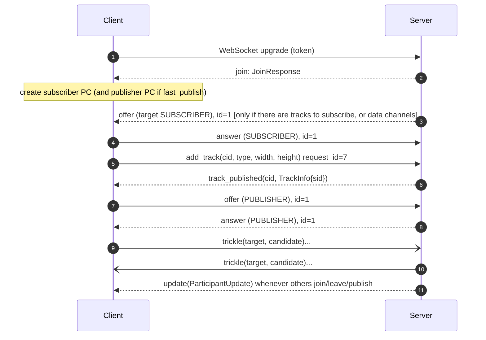
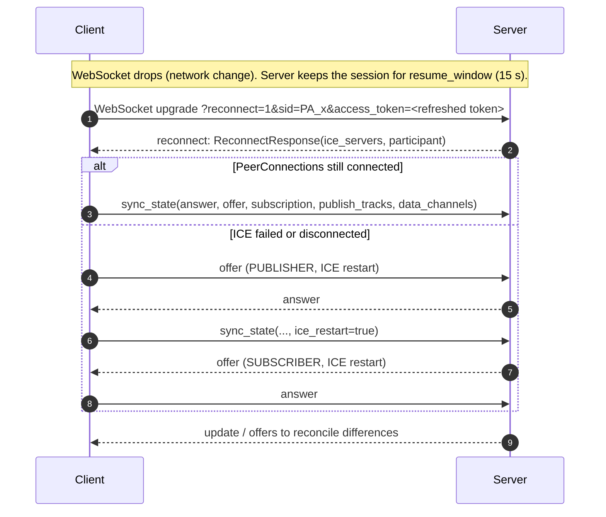

# Tessera protocol

This document specifies the signaling protocol (client ↔ server), the admin API, webhooks and
the recorder worker protocol. The normative schemas are the `.proto` files in
[`proto/tessera/v1`](../proto/tessera/v1); this document gives semantics and sequencing.
Design rationale: ADR-0002, ADR-0003, ADR-0004, ADR-0007 and ADR-0008.

- Protobuf package: `tessera.v1` (additive changes only).
- Signaling protocol version: **1** (`ServerInfo.protocol` = max, `ServerInfo.min_protocol` = min).

## 1. Code generation

| Language | Generator | Output | How |
|----------|-----------|--------|-----|
| Go | `protoc-gen-go` v1.36.12 (local plugin) | `gen/go/tessera/v1` (checked in), package `tesserav1` | `make proto` (runs `buf lint` + `buf generate`) |
| TypeScript | `@bufbuild/protoc-gen-es` 2.x (`target=ts`) | `sdk/js/src/gen` (checked in) | `cd sdk/js && npm run generate` (uses `sdk/js/buf.gen.yaml`, input `../../proto`) |
| Java | `protoc` 4.36.x via `io.github.ascopes:protobuf-maven-plugin` | `sdk/java/target/generated-sources` (not checked in), package `io.github.keshavgoyal26.tessera.proto.v1` | automatic in `mvn compile` |

CI runs `buf lint`, `buf breaking --against '.git#branch=main'` (on pull requests) and fails if
`buf generate` produces a diff against the checked-in Go code.

## 2. Signaling

### 2.1 Connecting

```
GET wss://<host>/rtc?access_token=<jwt>&protocol=1&auto_subscribe=1
                     &sdk=js&version=0.1.0&os=...&browser=...&browser_version=...
                     [&reconnect=1&sid=<participant sid>&reconnect_reason=<n>]
                     [&format=json]
Upgrade: websocket
```

| Parameter | Required | Meaning |
|-----------|----------|---------|
| `access_token` | yes (or `Authorization: Bearer`) | JWT with `grants.room_join` and `grants.room` (ADR-0004) |
| `protocol` | yes | Signaling protocol version the client speaks |
| `auto_subscribe` | no (default `1`) | Subscribe to every track automatically |
| `sdk`, `version`, `os`, `os_version`, `browser`, `browser_version`, `device_model` | no | Populates `ClientInfo` |
| `reconnect`, `sid` | resume only | Resume an existing session (section 2.6) |
| `format` | no | `json` for protojson text frames (debugging); default binary protobuf |

HTTP errors before upgrade: `401` invalid/expired token, `403` missing grant,
`404` room does not exist and auto-create is disabled, `409` resume impossible (`sid`
unknown), `426` unsupported `protocol`, `429` room, node or participant limit reached, `503` draining.
The body is a JSON `{"code": "...", "msg": "..."}`.

Subprotocol: clients may send `Sec-WebSocket-Protocol: tessera.v1`; the server echoes it.

### 2.2 Framing and general rules

- One protobuf message per WebSocket message. Client sends `SignalRequest`, server sends
  `SignalResponse`. Max message size: 1 MiB (SDP of very large rooms fits comfortably).
- Unknown fields and unknown `oneof` cases are ignored (forward compatibility).
- `request_id` (client-chosen, non-zero) correlates requests with `RequestResponse`.
- Messages are processed in order per session. The server never blocks a room on a slow
  socket: if the session's write queue (default 256 messages) overflows, the server sends
  `ErrorResponse{code=ERROR_CODE_SLOW_CONSUMER}` if possible and closes the connection.
- WebSocket close codes: `1000` normal (after `LeaveRequest`), `1001` server going away,
  `4001` auth expired, `4003` permission revoked, `4008` ping timeout, `4009` duplicate
  identity, `4010` protocol error.

### 2.3 Join sequence



Rules:

1. `JoinResponse` is always the first server message. It contains the room, the
   participant's own `ParticipantInfo`, all other visible participants with their tracks,
   ICE servers (TURN credentials are per session), ping settings and publish codecs.
2. The client must send `add_track` **before** the publisher offer that contains the
   track. The server matches the SDP `msid` track id with `cid`. Unmatched tracks in an
   offer are rejected (`RequestResponse{REASON_INVALID}`) and their transceivers set
   inactive in the answer.
3. One stream per track: video is H.264, audio Opus (or RED around Opus). Simulcast is not
   supported (ADR-0012): `add_track` with more than one entry in `layers` (or with
   `simulcast_codecs`) is rejected with `REASON_INVALID`, and the server negotiates no RID
   header extensions, so a browser publishes a single stream. `TrackInfo.layers` and
   `TrackInfo.simulcast` stay empty.
4. `SessionDescription.id` is a per-PC counter set by the offerer; answers echo it. A stale
   answer (id lower than the latest offer) is ignored.
5. Candidates may be trickled before the remote description is set; both sides queue them.
   `final=true` signals end-of-candidates.
6. The server sends `offer` on the subscriber PC whenever subscriptions change (debounced
   50 ms, at most one outstanding). The client must answer each offer.
7. `track_subscribed` is sent when the first packet of a subscribed track has been forwarded
   (lets clients measure time-to-first-frame).
8. `ParticipantInfo.version` increases with every snapshot of a participant. Updates can arrive
   out of order (for example camera and mic published together): a client ignores an update
   whose version is not higher than the last one it applied for that sid, and any update about a
   sid it has seen DISCONNECTED. 0 means an older server; apply it.

### 2.4 Subscriptions and quality

- With `auto_subscribe=1`, the server subscribes the participant to every track it is allowed
  to see. Otherwise the client uses `subscription{track_sids, subscribe=true}`.
- `track_setting` carries the subscriber's preferences per track: `disabled` (or `quality`
  OFF) pauses the track without unsubscribing, and `priority` orders bandwidth allocation.
  `quality` (other than OFF), `width`/`height` and `fps` are ignored: each track has one
  stream.
- The server pauses video that does not fit the subscriber's bandwidth, in priority order,
  and tells the subscriber with `stream_state_update{PAUSED}`; it resumes with `ACTIVE`.
  When every wanted video is paused, it resumes one on trial after a back-off (5 s,
  doubling to 60 s) so its own traffic measures the link.
- `subscribed_quality_update` (dynacast) and `update_layers` are no longer sent or handled.
- `subscription_response` reports failures (`TRACK_NOT_FOUND`, `PERMISSION_DENIED`,
  `CODEC_UNSUPPORTED`).

### 2.5 Other messages

| Message | Direction | Semantics |
|---------|-----------|-----------|
| `mute` | C→S | Mute/unmute own track; server stops forwarding and notifies others via `update`. Muted video tracks still keep the transceiver. |
| `mute` | S→C | Admin muted one of the client's tracks; client must mute locally. |
| `unpublish_track` | C→S | Remove a published track; the client also removes the transceiver in its next offer. |
| `track_unpublished` | S→C | Server (admin) unpublished one of the client's tracks. |
| `update_metadata` | C→S | Requires `can_update_own_metadata`. |
| `speakers_changed` | S→C | Active speaker changes (only changed entries; `active=false` when someone stops). |
| `connection_quality` | S→C | Every 5 s, changed entries only, for self and others. |
| `room_update` | S→C | Room metadata/recording flag changed. |
| `refresh_token` | S→C | New token valid for reconnects; sent ~5 min before expiry. |
| `ping` / `pong` | C→S / S→C | Every `ping_interval` s (default 5); timeout `ping_timeout` (default 15). |
| `leave` | both | C→S: client leaves. S→C: server ends the session with `reason` and `action` (DISCONNECT, RESUME, RECONNECT). |
| `error` | S→C | Not tied to a request; may be followed by close. |

Data: two data channels on the **publisher** PC, created by the client: `_reliable`
(ordered) and `_lossy` (unordered, `maxRetransmits=0`). Payloads are `DataPacket` protobufs.
The server forwards them to recipients' subscriber-PC data channels (created by the server,
same labels) after setting `participant_identity`. Requires `can_publish_data`.

### 2.6 Reconnect and resume



- The server keeps a disconnected session (PCs, receivers, downtracks) for `resume_window`.
  Media continues to flow if ICE is still connected.
- If resume is impossible (`sid` unknown or expired), the upgrade fails with HTTP 409 and the
  client performs a **full reconnect**: a new join with the same identity, republishing its
  tracks. Other participants see the old participant leave and the new one join.
- The server initiates migrations with `leave{action=RESUME}` (reconnect to the same URL) or
  `leave{action=RECONNECT}` (rejoin, possibly another node) during drains.
- A second join with the same identity disconnects the first session with
  `DISCONNECT_REASON_DUPLICATE_IDENTITY` (close code 4009).

#### ICE restart without a rejoin

When the device changes networks while the WebSocket is still up (the browser fires `online` or
`navigator.connection` `change`, or a PeerConnection stays `disconnected` for 3 s), the SDK calls
`Room.restartIce()`: it sends `sync_state{ice_restart=true}` and a PUBLISHER offer created with
`iceRestart`. The server answers the offer and, on `ice_restart`, restarts ICE on the SUBSCRIBER
connection (new offer with fresh credentials, no media renegotiation). The participant sid, the
published tracks, subscriptions and down tracks are untouched, and no `reconnecting` state is
entered. A `sync_state` without the flag never restarts ICE, so a plain signaling resume does not
interrupt healthy media.

### 2.7 Permissions

Every request is checked against the participant's current `ParticipantPermission`
(initialised from token grants, changed by `UpdateParticipant`). On a permission downgrade
the server unpublishes now-forbidden tracks, unsubscribes if `can_subscribe` became false,
and sends an `update` with the new permission.

## 3. Admin API (Twirp)

```
POST /twirp/tessera.v1.RoomService/<Method>
POST /twirp/tessera.v1.RecordingService/<Method>
POST /twirp/tessera.v1.RecorderWorkerService/<Method>    (recorder workers only)
Authorization: Bearer <jwt>
Content-Type: application/protobuf | application/json
```

- JSON uses canonical protojson: lowerCamelCase names on output, both lowerCamelCase and
  original snake_case accepted on input; enums as names; 64-bit integers as strings.
- Success: HTTP 200 with the response message in the request's content type.
- Error: HTTP status per code, body `{"code":"not_found","msg":"room not found","meta":{}}`.

| Twirp code | HTTP | Typical cause |
|------------|------|---------------|
| `invalid_argument` | 400 | missing room name, bad identity |
| `malformed` | 400 | undecodable body |
| `unauthenticated` | 401 | missing/invalid token |
| `permission_denied` | 403 | missing grant |
| `not_found` | 404 | room/participant/track/recording not found |
| `already_exists` | 409 | duplicate |
| `resource_exhausted` | 429 | rate or capacity limit |
| `internal` | 500 | bug |
| `unimplemented` | 501 | method not implemented (Phase 0 stubs) |
| `unavailable` | 503 | draining, no recorder capacity |

Required grants per RPC are documented in `admin.proto` and `recording.proto`. Example:

```bash
curl -s http://localhost:7880/twirp/tessera.v1.RoomService/CreateRoom \
  -H "Authorization: Bearer $TOKEN" -H 'Content-Type: application/json' \
  -d '{"name":"standup","emptyTimeoutSeconds":300}'
```

## 4. Webhooks

The server POSTs a `WebhookEvent` to each configured URL.

```
POST <url>
Content-Type: application/json            (or application/protobuf, per endpoint config)
Tessera-Event-Id: 6f1c...-uuid
Tessera-Event-Type: WEBHOOK_EVENT_TYPE_PARTICIPANT_JOINED
Tessera-Key: <api key>
Tessera-Signature: t=1793800000,v1=5257a869e7ecebeda32affa62cdca3fa51cad7e77a0e56ff536d0ce8e108d8bd
```

Signature: `hex(HMAC-SHA256(secret_of(Tessera-Key), "<t>." || raw_body))`. Receivers must:
1. look up the secret for `Tessera-Key`;
2. recompute the HMAC over the **raw** body bytes and compare in constant time;
3. reject when `|now - t| > 300 s`;
4. deduplicate by `Tessera-Event-Id` (delivery is at-least-once).

A 2xx response acknowledges the event; anything else (or a timeout of 10 s) is retried with
exponential backoff from 1 s up to 5 min, at most 10 attempts. Events for one endpoint are
delivered in order. When the per-endpoint queue (default 1,000 events) overflows, the oldest
events are dropped and `num_dropped` on the next delivered event says how many.

| Event | When | Populated fields |
|-------|------|------------------|
| `ROOM_STARTED` | room created (by API or first join) | `room` |
| `ROOM_FINISHED` | room closed | `room` |
| `PARTICIPANT_JOINED` | participant became active | `room`, `participant` |
| `PARTICIPANT_LEFT` | participant left or removed | `room`, `participant` |
| `TRACK_PUBLISHED` | track published | `room`, `participant`, `track` |
| `TRACK_UNPUBLISHED` | track unpublished | `room`, `participant`, `track` |
| `RECORDING_STARTED` | recording became ACTIVE | `recording` |
| `RECORDING_UPDATED` | the live master playlist can be played (`recording.master_playlist_url`) | `recording` |
| `RECORDING_ENDED` | COMPLETE, FAILED or ABORTED | `recording` |

Hidden participants (recorders) do not generate participant events.

## 5. Recorder worker protocol

1. Worker → `ClaimJob{worker_id, available_capacity, wait_seconds≤30}` (long-poll). The
   Coordinator returns at most one `RecordingJob` whose cost fits the capacity, or an empty
   response at timeout.
2. The job contains `ws_url` and a **recorder token** (`room_join`, `hidden`, `recorder`,
   `can_subscribe`, `can_publish=false`, TTL 24 h with refresh via signaling).
3. Worker joins, subscribes to the targets, and reports `UpdateJob{status=ACTIVE}` once the
   first segment is written. A live recording then writes `master.m3u8` as soon as its tracks
   have a segment (again when another track gets its first one) and reports
   `UpdateJob{master_playlist_location, master_playlist_url}`: the master points at the live
   EVENT media playlists, so players can open it, rewind and catch up before the recording
   ends. The Coordinator sends `RECORDING_UPDATED` and, for a participant recording, sets the
   participant's `hls_url` attribute to the URL so everyone in the room can find it (edges
   mirror it to their viewers). A relative URL (`/recordings/...`, the `--dev` default for
   local storage) is on the server's HTTP port.
4. Worker → `Heartbeat` every 5 s; the response lists recordings to stop (from
   `StopRecording`). Missing heartbeats for 15 s mark the worker's jobs `FAILED`
   (or re-queued if still `STARTING`).
5. On stop: the worker flushes the last segment, writes the final `VOD` playlist with
   `EXT-X-ENDLIST`, uploads, and reports `COMPLETE` with final outputs.

## 6. Output layout (recording)

```
<prefix>/<recording_id>/
  master.m3u8                     # participant/composite recordings (written live, final at the end)
  quality.json                    # connection timeline (written every 12 s while recording, final at the end)
  <track_sid>/init.mp4            # ftyp + moov (avcC or dOps/esds)
  <track_sid>/index.m3u8          # media playlist (EVENT → VOD)
  <track_sid>/seg_00000.m4s       # moof + mdat fragments
  ...
```

`quality.json` is how the participant's media reached the recorder, one sample per 4 s of media
time (the player's `currentTime`), for players to draw under the scrubber:

```json
{"step_ms": 4000, "final": false, "samples": [{"t": 16, "q": 3, "loss": 0, "gap_ms": 3750, "kbps": 0}]}
```

`q`: 0 good (under 3 % loss after retransmission, video flowing), 1 unstable (3-10 % loss or the
video paused 0.7-2 s), 2 poor (over 10 % loss or the video frozen 2 s or more), 3 no media (nothing
on any track for 2 s or more: disconnected). `gap_ms` is the longest video pause in the step (audio
pauses in silence are not counted); `kbps` what arrived on all tracks.

Media playlist example:

```
#EXTM3U
#EXT-X-VERSION:7
#EXT-X-TARGETDURATION:4
#EXT-X-MEDIA-SEQUENCE:0
#EXT-X-PLAYLIST-TYPE:VOD
#EXT-X-INDEPENDENT-SEGMENTS
#EXT-X-MAP:URI="init.mp4"
#EXT-X-PROGRAM-DATE-TIME:2026-11-04T10:00:00.000Z
#EXTINF:4.000,
seg_00000.m4s
#EXTINF:3.967,
seg_00001.m4s
#EXT-X-ENDLIST
```
